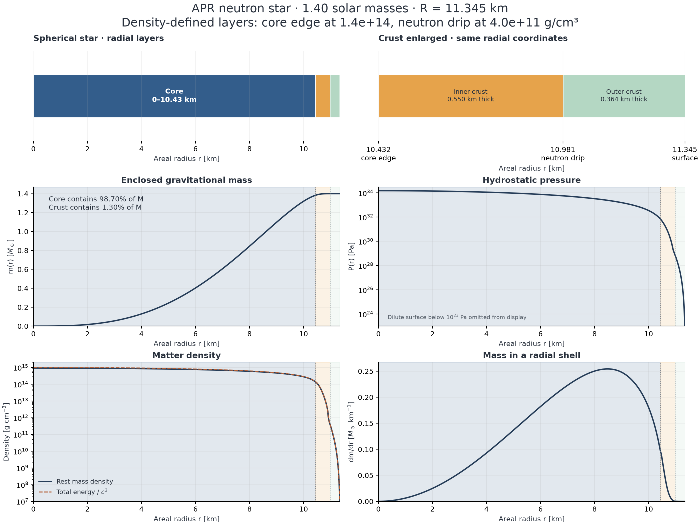

# APR neutron-star structure: simulation results

The governing equations and implementation map are in [MODEL.md](../MODEL.md).
In geometric units, with total energy density $\mathcal E$,

$$
\frac{dm}{dr}=4\pi r^2\mathcal E,\qquad
\frac{dh}{dr}=-\frac{m+4\pi r^3P}{r(r-2m)},\qquad
I=\frac J\Omega,\qquad \Lambda=\frac{2k_2}{3C_\star^5}.
$$

Generated by `run.py`; exact inputs are in `config_used.json`. Numerical checks: **PASS**.

## Connection to the probing paper

Miao & Yang, *Probing Intrinsic Ellipticity in Compact Star Binaries*, local arXiv:2511.08895v2 (20 Aug 2026), Fig. 2 and Sec. IV.
The Fig. 2 configuration is $M=1.4\,M_\odot$, $q=M'/M=3$, $\epsilon=5\times10^{-5}$,
initial orbital frequency 0.4 Hz, initial spin frequency 0.5 Hz, and $f-\theta=0.3986\,\mathrm{rad}$.
Here $M'=4.2\,M_\odot$. Sec. IV adopts APR and quotes $I=30.18$ $M_\odot^3$
(geometric units) and $\Lambda=248$ for a 1.4-solar-mass star. Its injection $q=5$
is a separate example; it is not substituted for Fig. 2's $q=3$.

This calculation builds the **spherical equilibrium background**, rather than evolving
the orbital/spin tracks of Fig. 2. The ellipticity, binary mass ratio and phase are retained
as context; they do not enter the spherical TOV equations. The prescribed equatorial
inertia difference $\epsilon I$ is 6.52725e+33 $\mathrm{kg\,m^2}$.
No magnetic/elastic mechanism is solved to produce that deformation.

## Global results

- Gravitational mass: 1.4000000006 solar masses.
- Areal/circumferential radius: **11.34495 km**.
- Central pressure: **1.496384e+34 Pa** = 1.496384e+35 $\mathrm{dyn\,cm^{-2}}$.
- Central rest mass density: 9.190284e+14 $\mathrm{g\,cm^{-3}}$.
- Central energy-equivalent density $\mathcal E/c^2$: 1.009775e+15 $\mathrm{g\,cm^{-3}}$.
- Relativistic moment of inertia: 30.110230 $M_\odot^3$ = 1.305451e+45 $\mathrm{g\,cm^2}$.
- Difference from the paper's quoted $I$: -0.2312%.
- Tidal deformability $\Lambda$: 247.61341; $k_2$=0.0746180.
- Difference from the paper's quoted $\Lambda$: -0.1559%.

The EOS family and benchmark observables agree closely with the paper. The exact EOS
table, interpolation and crust matching used by the authors are not specified there;
the small residual difference is not fitted away or claimed to have a known cause.
The APR table is used, not an APR4 piecewise-polytropic approximation.
A monotone PCHIP interpolant in $\ln P,\ln\mathcal E$ passes through every original
table point. It is densely sampled before LAL reconstructs enthalpy and rest mass
density. This removes a spurious negative-compressibility interval in LAL's native
coarse-table cubic spline near the inner crust. The original data are preserved;
both the original and derived tables and their checksums are saved in `data/`.
The comparison to LAL below uses the same derived EOS. Differences from its
native coarse interpolant at fixed central pressure are also recorded separately.

## Radial layers

These are **density-defined regions of the numerical solution**. The core-crust boundary
is set at rest mass density 1.400e+14 $\mathrm{g\,cm^{-3}}$ and neutron drip at 4.000e+11 $\mathrm{g\,cm^{-3}}$.
The neutron-drip scale follows Chamel & Haensel (2008); the exact core transition is
an additional configurable modeling choice. Neither boundary is inferred from $\epsilon$,
computed by a nuclear stability calculation, or specified by the probing paper.

| Region | Radial interval (km) | Coordinate thickness (km) | Gravitational mass contribution (solar masses) | Fraction of total $M$ |
|---|---:|---:|---:|---:|
| Core | 0.00000–10.43169 | 10.43169 | 1.38173826 | 98.69559% |
| Inner Crust | 10.43169–10.98144 | 0.54975 | 0.01823896 | 1.30278% |
| Outer Crust | 10.98144–11.34495 | 0.36351 | 0.00002278 | 0.00163% |

At the core edge $P$ = 7.060833e+31 Pa and
$m$ = 1.38173826 solar masses.
At neutron drip $P$ = 7.205245e+28 Pa and
$m$ = 1.39997722 solar masses.

Radii are Schwarzschild areal coordinates. A shell's proper radial thickness is
$\int dr/\sqrt{1-2Gm/(rc^2)}$; this different quantity is also saved in `layers.csv`.
Layer masses are differences in enclosed **gravitational mass**, not baryonic masses
or proper-volume integrals of rest mass density. The radial mass distribution uses
total energy density including internal energy. `profiles.csv` distinguishes both densities.

## Boundary sensitivity

Only the classification threshold is changed below; the EOS and equilibrium star stay fixed.
This illustrates uncertainty in assigning the core edge; it is **not** a crust-EOS uncertainty study.

| Core threshold ($\mathrm{g\,cm^{-3}}$) | Core radius (km) | Total coordinate crust thickness (km) |
|---|---:|---:|
| 1.00e+14 | 10.53035 | 0.81460 |
| 1.40e+14 | 10.43169 | 0.91326 |
| 2.00e+14 | 10.27161 | 1.07334 |

## Numerical validation

The implementation is checked against LAL's independent TOV/Love integrator at the
same central pressure. Resolution is checked with a smaller step, tighter tolerance
and smaller central starting radius. Lowering the numerical surface enthalpy cutoff
by ten tests the unintegrated dilute atmosphere. The surface pressure is small but
finite (2.8918e+07 Pa), not exactly zero.

Full metrics and explicit acceptance limits are in `validation.json`. Additional checks
cover target mass, monotonic profiles, mass quadrature, positive stable-branch slope,
and causal sound speed in the density range sampled by this star. A 12,000-point
enthalpy scan checks EOS stability between radial samples, and doubling the dense
EOS sampling checks that resampling errors are negligible. Passing these does
not validate APR at all densities or determine systematic physical uncertainties.

## Scope and sources

- Cold, isotropic, nonrotating spherical hydrostatic equilibrium; Hartle first-order
  rotation computes $I$ without altering the TOV density or pressure profile.
- A barotrope alone does not identify nuclear species, pasta, superfluid regions or
  the chemical crust-core instability. The LAL two-column APR table includes a low-density
  extension, but carries no composition/phase flags; this project makes no unverified
  claim about its precise crust splice.
- The figure's slow rotation and $\epsilon=5\times10^{-5}$ motivate a spherical background; magnetic
  stresses, finite temperature, accretion, tides and deformation corrections are omitted.
- The pressure plot shows $P\geq10^{23}\,\mathrm{Pa}$ and the density plot $\rho\geq10^7$ $\mathrm{g\,cm^{-3}}$ for
  readability; the CSV includes the full profile to the numerical surface.
- [Probing paper](https://arxiv.org/abs/2511.08895v2), Fig. 2 and Sec. IV.
- [Akmal, Pandharipande & Ravenhall (1998)](https://arxiv.org/abs/nucl-th/9804027).
- [Chamel & Haensel (2008)](https://arxiv.org/abs/0812.3955), crust structure and neutron drip.
- [LAL EOS documentation](https://lscsoft.docs.ligo.org/lalsuite/dev/lalsimulation/group___l_a_l_sim_neutron_star_e_o_s__c.html).
- [Hartle (1967)](https://doi.org/10.1086/149400), relativistic slow rotation.
- [Hinderer (2008), including corrected expressions](https://arxiv.org/abs/0711.2420), tidal Love numbers.

