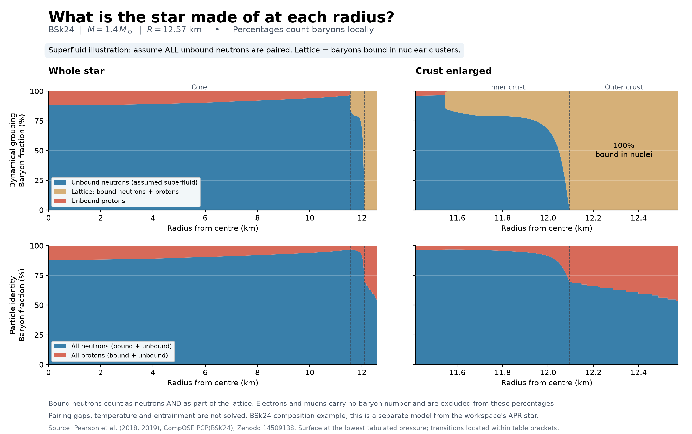

# Radial composition: the separate BSk24 star



This calculation uses PCP(BSK24) for **both** composition and a new spherical
$1.4\,M_\odot$ TOV solution. It is independent of the APR star and its inspiral.
The equations, archive-column mapping and interpolation rules are in
[COMPOSITION.md](../../COMPOSITION.md); the implementation is
[`plot_composition.py`](../../plot_composition.py).

## Saved results

These values come from the adjacent `summary.json`:

| Quantity | Result |
|---|---|
| Areal radius | $12.57415\,\mathrm{km}$ |
| Central neutron / proton baryon fractions | $88.1298\%$ / $11.8702\%$ |
| Core–crust boundary midpoint | $11.54552\,\mathrm{km}$ |
| Core–crust radius bracket | $11.53885$–$11.55117\,\mathrm{km}$ |
| Neutron-drip midpoint | $12.09531\,\mathrm{km}$ |
| Neutron-drip radius bracket | $12.09299$–$12.09824\,\mathrm{km}$ |
| Surface pressure | $9.0\times10^{-12}\,\mathrm{MeV\,fm^{-3}}$ |

The star ends at the lowest tabulated pressure, without an atmospheric extension.
Refining the TOV integration changes the radius by about
$3.94\times10^{-4}\,\mathrm{m}$. The supplied mass–radius sequence instead gives
$12.59028\,\mathrm{km}$ at this mass, about $16.13\,\mathrm{m}$ larger.
Numerical refinement does not eliminate differences in interpolation and the
surface prescription.

## What the figure counts

The top panels partition **local baryon number** into unbound neutrons, nucleons
bound in lattice nuclei, and unbound protons. The bottom panels partition the
same baryons into all neutrons and all protons. Bound neutrons belong to the
lattice grouping and also to neutron identity. The lattice fraction is therefore
not the proton fraction. There is no nuclear lattice in the homogeneous core.

Charge neutrality supplies total protons, including those bound in nuclei:

$$
Y_p=Y_e+Y_\mu,\qquad Y_n=1-Y_p,\qquad
Y_{\rm bound}=1-Y_{n,\rm free}-Y_{p,\rm free}.
$$

Electrons and muons have no baryon number and are excluded from the denominator.
These fractions are not stellar mass fractions, inertia fractions or volume
filling factors. In a two-fluid interpretation the lattice/charged component
also contains bound neutrons and leptons.

**The superfluid illustration assumes all unbound neutrons are paired:**
$Y_{n,\rm paired}=Y_{n,\rm free}$. Actual superfluid density needs temperature,
pairing and entrainment inputs. Proton superconductivity is not determined here.

## Interpolation and reproducibility

Composition is linear in $\ln n_b$ within each tabulated phase, with steps between
phases. Transitions use geometric midpoints $n_{\rm tr}=\sqrt{n_-n_+}$ of the
reported density brackets. They are plotting choices within those brackets,
not resolved coexistence densities. Thermodynamics use monotone PCHIP in log
pressure and energy density.

Run from the project root:

```sh
.venv/bin/python plot_composition.py
```

The script replaces `radial_composition.png`, `.svg`, `.pdf`, the radial CSV and
`summary.json`. The summary records fraction checks, mass accuracy, phase
brackets, radius refinement, assumptions and archive checksums. This README is a
review guide for the saved run and is not regenerated by that command.

Sources: [CompOSE PCP(BSK24)](https://compose.obspm.fr/eos/253),
[frozen Zenodo version 1](https://zenodo.org/records/14509138), and the original
README inside `../../data/PCP_BSK24_nparam_1.zip`. The published archive MD5 is
`57a9af0939caa9c3621baa28471b2dfd`. Model references include Pearson et al. (2018)
and its 2019 correction; see the archive for the complete references.
