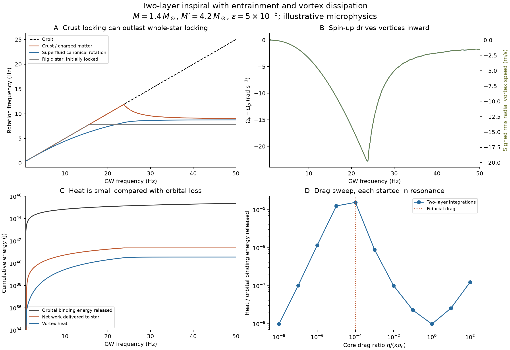
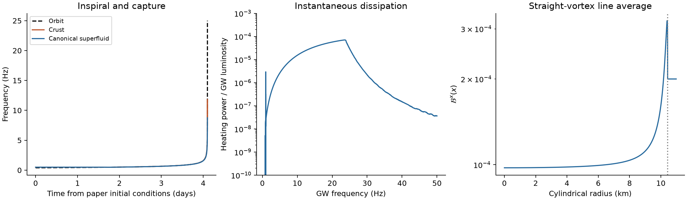

# Two-component inspiral, spin-orbit locking and vortex heating

The [model guide](../../inspiral/MODEL.md) defines the two canonical rotators,
line integrals and circular Hamiltonian. The heat and spin budgets obey

$$
\omega=\Omega_v-\Omega_p,\qquad
\dot\Omega_v=-2\mathcal B_{\rm eff}\Omega_v\omega,\qquad
P_{\rm heat}=2I_v\mathcal B_{\rm eff}\Omega_v\omega^2,
$$

$$
\Delta E_{\rm spin}+Q=W_\star,\qquad
\Delta(E_K+U+E_{\rm spin})+Q+E_{\rm GW}=0.
$$

## Result

For the specified illustrative microphysics, **vortex dissipation does not remove
a large fraction of the orbital energy**. Starting with the probing paper's
Fig. 2 inputs and evolving from GW frequency 0.8 to 50 Hz gives:

| Quantity | Two-layer result |
|---|---:|
| Duration | 4.100477 days |
| Orbital binding energy released | 2.335184e+45 J |
| Net quadrupole work delivered to star | 2.341504e+41 J |
| Increase in stellar rotational energy | 1.986436e+41 J |
| Vortex heat | 3.550678e+40 J = 3.550678e+47 erg |
| Heat / orbital binding energy released | 1.520513e-05 (0.001521%) |
| Heat / net work delivered to star | 15.164% |
| Maximum instantaneous heat / GW luminosity | 7.034428e-05 |
| Captured in the 0.8-1.0 Hz orbital window | True |
| First full phase slip after capture | 24.098 Hz GW |
| Final crust / canonical superfluid frequency | 9.02613 / 8.74872 Hz |

Positive net stellar work equals rotational-energy increase plus heat, within the
recorded numerical error. Heat is not an additional orbital torque. It can be a
substantial part of the much smaller energy budget delivered to the star while
remaining tiny relative to the energy lost by the orbit. No temperature increase
is inferred: heat capacity, cooling, pairing and thermal feedback are not evolved.

## Meaning of two layers

There are **two effective rotational components**: p is the crust plus tightly
coupled charged matter; v is the canonical superfluid reservoir. The v component
is not the inertia of microscopic vortex cores. Core and inner-crust zones have
separate prescribed microphysics, and the outer crust is entirely in p. Straight
vortices thread both superfluid zones. This implements the rigid/body-averaged
reduction in Antonelli & Pizzochero Sec. 3.1, retaining the nonlinear factor
$2\Omega_v$; it does not solve their differential-rotation PDE.

The saved APR TOV profile is used for density, radius and layer boundaries. Its
Newtonian baryon-density inertia integrals are multiplied by a common factor
1.331996 to match the saved Hartle total
$I$ = 1.305451e+38 $\mathrm{kg\,m^2}$. The effective fractions are
$I_v/I$ = 0.838264 and $I_p/I$ = 0.161736. This is a Newtonian
two-fluid dynamics model calibrated to the relativistic total inertia, rather than
a relativistic entrained stellar perturbation calculation. The outer rotator is
not a geometrically isolated shell: it includes charged matter throughout the core.

## Physical inputs and controlled comparisons

The stellar mass is $M=1.4\,M_\odot$, the companion-to-star mass ratio is $q=3$,
and the fixed total-star ellipticity is $\epsilon=5\times10^{-5}$.
The quadrupole difference is $\Delta I=\epsilon I$, carried by the p component;
it is not changed to $\epsilon I_p$.
The original initial frequencies are orbital 0.4 Hz and spin 0.5 Hz, with
$f-\theta=0.3986\,\mathrm{rad}$. Both components initially corotate. The fiducial paper-start
run explicitly tests capture; no locking constraint is imposed during evolution.

The rigid control started at the identical original phase does not capture in
the 0.8-1.0 Hz orbital window (capture flag:
False). The small circular
backreaction and phase accumulation can alter capture relative to the paper's
neglected-backreaction example. The reported 0.3986 phase is rounded and does not
guarantee capture under changed equations or constants. No initial phase is tuned
to force a rigid reproduction of Fig. 2. The separate rigid, initially locked
trajectory is the appropriate control for conditional locking evolution.

| Assumption | Core | Inner crust |
|---|---:|---:|
| Superfluid neutron mass fraction | 0.9 | 0.8 |
| Entrainment $\varepsilon_n=1-m_n^*/m_n$ | -0.05 | -4.0 |
| Drag ratio $\eta/(\kappa\rho_n)$ | 0.0001 | 0.001 |
| Freely moving vortex fraction $Y$ | 1.0 | 1.0 |

These constants are **assumed sensitivity inputs**, not microphysics extracted
from the APR barotrope or a fit to either paper. No finite critical pinning force
or thermal creep law is specified. The $Y=0$ case is a permanently pinned limiting
control, with zero vortex motion and zero heating; finite-threshold unpinning and
glitches are outside this model. A suppressed-mobility $Y=10^{-3}$ case is also included.

The drag sweep starts each trajectory already in the stable resonant island at
orbital frequency 0.6 Hz with corotating
components. These are **conditional-on-capture** comparisons, not capture
probabilities. The crust-to-core drag ratio is fixed at
10.0. The sweep reaches both sides of the drag law:
more microscopic drag does not always mean more radial vortex motion.

| Core drag ratio | Mean $\mathcal B_{\rm eff}$ | Heat (J) | Heat / orbital loss | First full phase slip (GW Hz) |
|---:|---:|---:|---:|---:|
| 1e-08 | 1.080e-08 | 2.247e+37 | 9.82924e-07% | 49.85 |
| 1e-07 | 1.080e-07 | 2.292e+38 | 1.00263e-05% | 49.85 |
| 1e-06 | 1.080e-06 | 2.642e+39 | 0.000115591% | 49.81 |
| 1e-05 | 1.080e-05 | 2.865e+40 | 0.00125309% | 48.51 |
| 1e-04 | 1.080e-04 | 3.551e+40 | 0.00155314% | 24.09 |
| 1e-03 | 1.080e-03 | 2.018e+39 | 8.82887e-05% | 16.15 |
| 1e-02 | 1.080e-02 | 2.273e+38 | 9.94425e-06% | 15.82 |
| 1e-01 | 1.062e-01 | 5.192e+37 | 2.27128e-06% | 15.83 |
| 1e+00 | 4.616e-01 | 2.229e+37 | 9.75233e-07% | 15.83 |
| 1e+01 | 8.305e-02 | 5.840e+37 | 2.55442e-06% | 15.83 |
| 1e+02 | 8.373e-03 | 2.830e+38 | 1.23784e-05% | 15.82 |

The largest integrated heat in this sampled sweep is 3.5505e+40 J,
or 0.00155% of orbital loss.
This is a maximum over the sampled inputs, not a universal bound.

## Locking, vortex motion and orbital phase

In the spin-up portion of resonance $\Omega_p$ exceeds $\Omega_v$. The negative lag
drives vortices inward, increasing their areal density and spinning up the
superfluid. Entrainment changes the effective inertias and line-averaged mobility;
it produces no heat by itself. Drag produces nonnegative heat for either lag sign.
With the assumed inputs, the crust can remain locked while the superfluid lags,
reducing the instantaneous inertia load and extending crust locking. This effect
is distinct from increasing the star's ellipticity.

The ideal rigid, initially locked control first completes a phase slip at
15.835 Hz GW; the analytic quasistatic rigid torque
limit is 15.084 Hz GW. The paper quotes
about 14.2 Hz for its finite-amplitude illustrative trajectory. A full phase slip
is an operational endpoint and need not equal the torque-limit frequency or the
first departure from frequency tracking. Initial phases and capture amplitudes
matter. The phase-slip diagnostic here uses a fixed reference at orbital 1 Hz.

The fiducial time-domain GW phase difference from a point particle at matched
frequency is -60.118 rad over
the entire 0.8-50 Hz GW interval. It includes conservative spin-up, changed locking
and dissipation together; it is not an isolated dissipative phase shift, the
frequency-domain phase in the paper's Eq. (6), or a detectability estimate.
Small fractional energy transfer can accumulate an appreciable phase over days.

## Energy-transfer bound at fixed ellipticity

The maximum quadrupole torque power at the initial orbital frequency, divided by
the GW luminosity, is 0.001043.
It decreases approximately as $n^{-1/3}$. Thus this channel cannot remove
order-unity orbital energy for the specified masses, ellipticity and frequency
range, regardless of how efficiently vortices dissipate the delivered work.
The absolute-torque integrated upper bound, allowing either sign of the actual
torque, its feedback on the chirp, and the small interaction-frequency correction, is
9.8130e+41 J,
0.0420% of orbital binding energy
released. This is a bound on orbital torque work; initial spin and interaction
energy must also be included when bounding total heat. See [MODEL.md](../../inspiral/MODEL.md) for the derivation.
This does not bound other orbital dissipation channels such as dynamical tides,
resonant stellar modes, magnetic interactions or vortex-flux-tube cutting, which
are absent from the model.

## Validation and reproducibility

Validation status: **PASS**. The run checks energy and angular
momentum balance, nonnegative heating, convergence under tighter integration
tolerances, and doubled line/cylindrical quadrature. Independent unit tests cover
isolated lag relaxation and its exact heat budget, the closed quadrupole
Hamiltonian, point-particle inspiral, and zero/infinite drag limits.
Detailed values and thresholds are in validation.json. Input checksums, versions,
parameters and all scenario summaries are in summary.json and config_used.json.
Trace CSV files are decimated to at most 15,000 rows for convenient inspection;
the energy diagnostics use the full adaptive solution plus a dense output grid.

Run from the `numerical-simulation` folder with
`.venv/bin/python inspiral/run.py`; use `--config` and `--output` to select other
paths. Rerun tests from that folder with
`.venv/bin/python -m unittest discover -s inspiral -p 'test_inspiral.py' -v`.

## Scope and sources

Large lags and a strongly radius-dependent $\mathcal B^x$ may invalidate the rigid projection;
the full AP PDE can develop differential rotation and vortex pile-up that this
two-component truncation cannot resolve. The nonaxisymmetric quadrupole is added
as a small external perturbation to an axisymmetric spherical background.
Turbulence, line bending, magnetic stress evolution, superfluid phase transitions,
finite-temperature feedback and dynamical tides are not simulated. A fixed
quadrupole in a magnetar does not establish which dissipation mechanisms are
active in its core. Results are conditional model calculations, not a measured or
unique neutron-star microphysical prediction. See [MODEL.md](../../inspiral/MODEL.md)
for equations and conventions.

- Antonelli & Pizzochero, *Axially symmetric equations for differential pulsar
  rotation with superfluid entrainment*, MNRAS 464, 721 (2017),
  [arXiv:1603.02838v4](https://arxiv.org/abs/1603.02838v4),
  [DOI](https://doi.org/10.1093/mnras/stw2376): Eqs. (2)-(7), (11), (13),
  (15), (18)-(22), (26)-(27), and the rigid reduction in Sec. 3.1.
- Miao & Yang, *Probing Intrinsic Ellipticity in Compact Star Binaries*,
  [arXiv:2511.08895v2](https://arxiv.org/abs/2511.08895v2),
  Secs. II-III and Fig. 2. The circular orbital backreaction is implemented with
  a Hamiltonian and radiation flux, as explained in [MODEL.md](../../inspiral/MODEL.md).
- Existing local APR background: ../summary.json and ../profiles.csv. Those
  files and their original equilibrium outputs are unchanged by this simulation.
